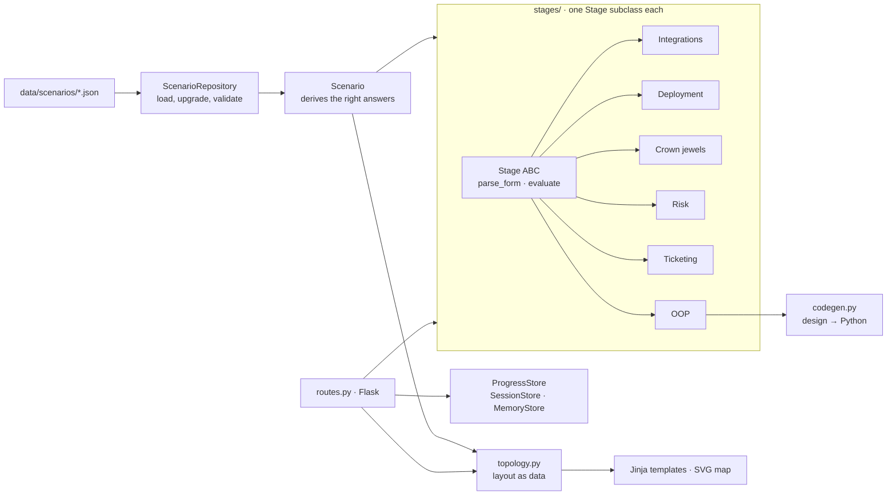

# exposure-sim

A browser game for practicing the job of an **exposure management implementation engineer**:
you walk into a customer's existing network, then fit a vulnerability/exposure management
platform on top of it.

Each fictional organization has its own scanners, ticketing systems, network zones, and
constraints. You work through six stages, see your decisions drawn over the customer's
network map, and get graded. Weak answers get a Socratic question before you can lock them in.

| # | Stage | What you decide |
|---|---|---|
| 1 | Integrations & gaps | Which sources to connect; which asset groups no scanner covers |
| 2 | Deployment model | SaaS only, SaaS + on-prem collector, or fully on-prem; what the collector reaches; which way it connects |
| 3 | Crown jewels | The wave-1 asset groups |
| 4 | Risk scoring | Which signals make up risk (CVSS, KEV, EPSS, exposure, criticality); KEV policy; P1 deadline |
| 5 | Tickets & ownership | Ticket grouping key, routing per team, unowned assets, rollout |
| 6 | Integration classes | The `BaseParser` contract, an optional middle class, and what each scanner's subclass overrides. Your design is turned into Python. |

Three organizations ship with it:

- **Harbor Lane Outfitters** (warm-up): all SaaS and AWS.
- **Prairie Freight Co.** (hybrid): on-prem data center plus AWS, internal Jira, a Qualys appliance that looks local but isn't.
- **Bureau of Regional Logistics** (federal-style): data can't leave the authorization boundary, a stale CMDB, unscannable OT.

All organizations, hosts, people, and data are fictional.

## Run it

Requires Python 3.11+.

```bash
python3 -m venv .venv && source .venv/bin/activate
pip install -r requirements.txt
python3 run.py            # http://127.0.0.1:5000
```

Progress is kept in a signed browser cookie. Set `EXPOSURE_SIM_SECRET` to keep it valid across
restarts (otherwise a new random key is generated on each start).

## Tests

```bash
pip install -r requirements-dev.txt
python3 -m pytest -q                  # 118 tests: scenarios, every stage, codegen, map layout, HTTP, full playthroughs
python3 scripts/check_map.py          # renders every map in headless Chromium and fails if any label overflows
```

`check_map.py` and `scripts/screenshot.py` need Playwright with Chromium (`pip install playwright && playwright install chromium`).

## How it's built



Design choices worth knowing if you extend it:

- **Right answers are derived, not hardcoded.** `Scenario` computes crown jewels, coverage
  gaps, the expected deployment model, and which systems a collector must reach from the
  scenario data. Grading rules that vary by org (crown-jewel criteria, acceptable P1 deadlines)
  live in each file's `rules` block.
- **Stages follow the same pattern the game teaches.** `Stage` is an abstract base class with a
  `parse_form` / `evaluate` contract, shared helpers, and a `@register` decorator, the same shape
  as the `BaseParser` you design in stage 6.
- **The map is computed as data.** `TopologyBuilder` returns zones, nodes, and edges with
  coordinates. The SVG template draws it, and `/play/<org>/topology.json` returns the same
  layout for any other frontend.
- **Storage sits behind one interface.** The app only calls `ProgressStore`. Swapping the
  cookie for a database is one new subclass passed to `create_app(store=...)`.
- **Forms are never trusted.** Every stage filters submitted values against the scenario's
  own ids before grading or storing them.

## Adding an organization

1. Copy a file in `data/scenarios/` and edit it. Ids must be unique; `covers`, `zone`,
   `owner`, and `works_in` must reference ids that exist.
2. Run `python3 -m pytest -q`. The loader validates references on startup, and the
   parametrized tests check that a perfect answer scores 100% on the new org.
3. Run `python3 scripts/check_map.py` to make sure every label fits its box.

Scenario files carry `schema_version`. When the format changes, bump `CURRENT_SCHEMA` in
`scenarios.py` and add an upgrade step so older files keep loading.

## Hosting it on a Raspberry Pi

See [`deploy/README.md`](deploy/README.md): one command hardens a fresh Pi and runs the game as a sandboxed systemd service.

## Before putting it on the internet

Built for local use. Before hosting it: set `EXPOSURE_SIM_SECRET`, serve over HTTPS, add CSRF
protection to the forms (e.g. Flask-WTF), and run it under a production WSGI server instead
of `run.py`.
